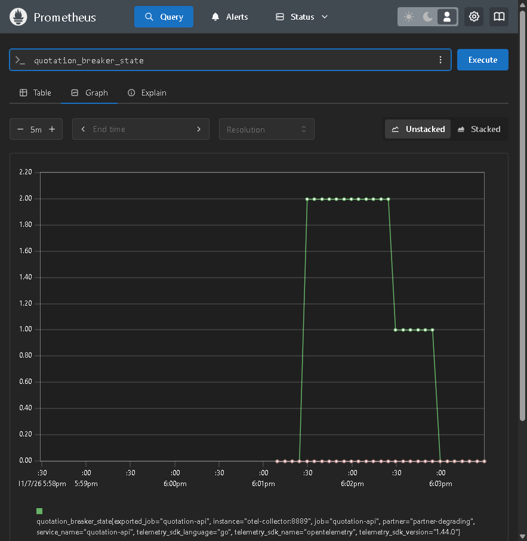

# Estado do breaker no tempo

Legenda: `partner-degrading` percorre fechado (0) → aberto (2) → meio aberto (1) → fechado (0); o aberto nasce na carga padrão e o meio aberto e o fechamento, na sonda logo depois.

## Sessão

Sessão separada da de `depois-reproduce.txt`, com o mesmo código, os mesmos perfis de parceira e a mesma carga padrão (10 de baseline, depois 200 com 50 em voo). Saída completa em `breaker-sessao-reproduce.txt`: os mesmos 200 sucessos em 200 e p95 de 4,36 s, contra 4,35 s na sessão do `depois`.

```
docker compose down -v
docker compose up -d --build --wait      # make reproduce, 1a linha
docker compose run --rm --build loadgen  # make reproduce, 2a linha (make load)
```

A carga vai das 18:01:13 UTC às 18:01:17 UTC. Ela termina em 4,4 s, dentro dos 5 s de `BREAKER_OPEN_SECONDS`, e o cache quente deixa de chamar a parceira; por isso o meio aberto não acontece dentro do loadgen. A sonda, com o ambiente ainda de pé, foi feita com duas cotações de placa nova (miss de cache), espaçadas em 25 s para o meio aberto atravessar o leitor de 10 s de `internal/platform/telemetry.go` e o scrape de 5 s:

| instante (UTC) | placa | resposta |
|---|---|---|
| 18:02:19 | `BRK1A01` | HTTP 200, `degraded=false`, 3 propostas. 1ª sonda da `partner-degrading`, que vai a meio aberto |
| 18:02:46 | `BRK1A02` | HTTP 200, `degraded=true`, `missing_partners=[partner-flaky]`, 2 propostas. 2ª sonda bem-sucedida, o circuito fecha |

As duas chamadas usam `X-Tenant-Id: corretora-a` e `POST http://localhost:8080/quotes`, com o corpo do exemplo do enunciado e só a placa trocada.

## Gráfico

PromQL, Prometheus em `http://localhost:9090`, aba Graph:

```promql
quotation_breaker_state
```

Janela do gráfico: 5 minutos terminando por volta das 18:03:20 UTC de 2026-11-07, resolução de 5 s. O relógio da UI está em UTC (18:02 aparece como 6:02pm). Os valores são os de `internal/partner/client.go`: 0 fechado, 1 meio aberto, 2 aberto. `partner-slow` e `partner-flaky` ficam em 0 a sessão inteira.

Mudanças da série `partner-degrading`, lidas de `/api/v1/query_range` com passo de 5 s:

| instante (UTC) | valor | estado |
|---|---|---|
| 18:01:09 | 0 | fechado |
| 18:01:29 | 2 | aberto, durante a carga |
| 18:02:29 | 1 | meio aberto, depois da 1ª sonda |
| 18:02:59 | 0 | fechado, depois da 2ª sonda |



## Contador de transições, no fim da sessão

```promql
sum by (partner, from_state, to_state) (quotation_breaker_transitions_total)
```

| partner | from_state | to_state | valor |
|---|---|---|---|
| partner-degrading | closed | open | 1 |
| partner-degrading | open | half_open | 1 |
| partner-degrading | half_open | closed | 1 |

A `partner-flaky` não abriu nesta sessão: a 2ª sonda recebeu 503 dela, mas uma falha isolada não chega às 5 consecutivas de `BREAKER_CONSECUTIVE_FAILURES`. O curto-circuito da `partner-flaky` está no trace de `trace-curto-circuito.json`, da sessão do `depois`.
