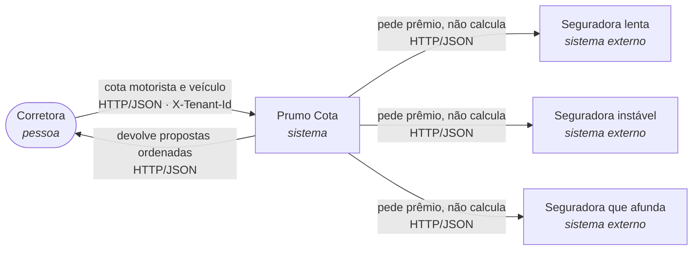
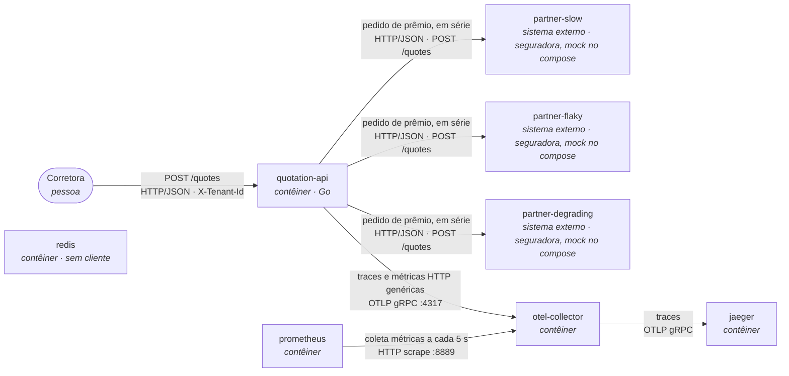
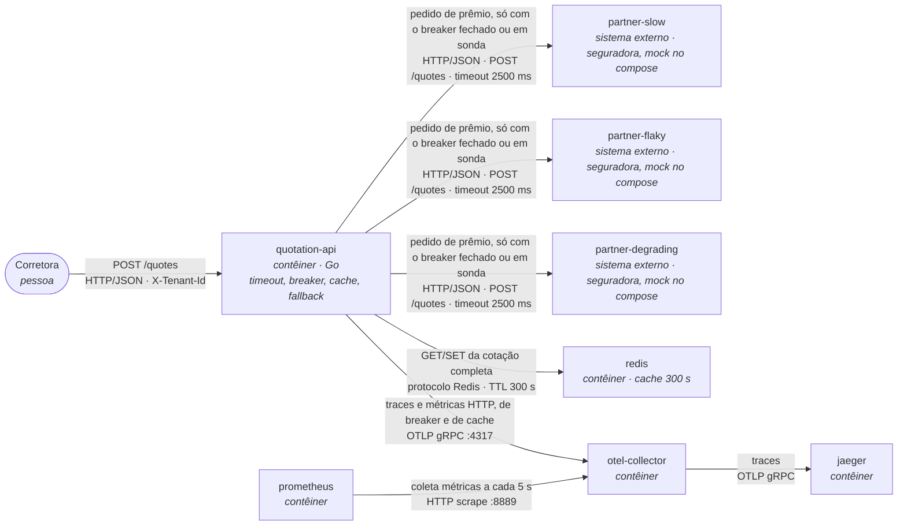
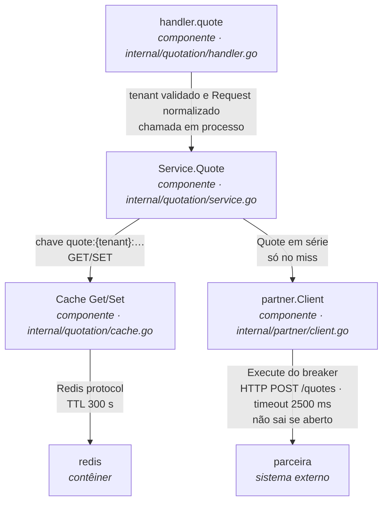

# SAD — Prumo Cota, proteção da cotação

Documento da plataforma depois desta intervenção. Serve a três leitores: o CTO, que aprova o gasto; quem opera a plataforma de madrugada; e o encarregado de dados, que precisa mostrar à ANPD e à SUSEP que a cotação servida de cache ou de fallback continua rastreável e que uma corretora não lê o prêmio de outra.

A medição desta máquina está em `docs/evidencias/antes-reproduce.txt` e `docs/evidencias/antes-p95.md`. Números de negócio (preço da consulta, volume, teto de 24 h, retenção de cinco anos) vêm do cenário do enunciado.

## 1. Introdução

### Propósito

A plataforma consulta três seguradoras em série e, hoje, devolve 502 quando qualquer uma falha. Este SAD fixa o timeout, o circuit breaker, o cache e o fallback antes do código, e amarra o custo da seção 8 ao TTL da seção 4 e ao pressuposto de recotação desta seção.

### Escopo

O documento cobre a plataforma de cotação e a fronteira com as seguradoras. A Prumo intermedia: não redesenha o motor de precificação das parceiras e não desenha o CRM da corretora. O prêmio continua sendo o que a parceira devolveu ou o que uma entrada de cache ainda válida guardou dessa consulta.

### Restrições

Impostas pelo cenário, não escolhidas aqui:

- Go 1.25, Docker Compose, Redis e o SDK já inicializado em `internal/platform/telemetry.go`.
- Três parceiras, com os perfis do `docker-compose.yml` (semente, taxa de falha, latências e degradação) intocados.
- Cobrança de R$ 0,04 por consulta ao motor da seguradora, três consultas por cotação completa.
- A Prumo é operadora na LGPD: CPF, ano de nascimento e placa viajam no corpo; a corretora viaja em `X-Tenant-Id`. Uso cruzado entre corretoras é incidente.
- SUSEP: cotação apresentada a um consumidor fica auditável por cinco anos, inclusive a servida de cache ou de fallback. A tabela de auditoria não entra nesta entrega; o custo entra na seção 8.
- Agregação permanece em série.

### Decisões

Escolhidas neste documento e repetidas no código: timeout de 2500 ms, breaker por parceira (5 falhas consecutivas, 5 s aberto, 2 sucessos para fechar), cache da cotação completa com TTL de 300 s, fallback parcial com `degraded` e `missing_partners`, hospedagem on-premise no Brasil (seção 5).

### Pressupostos

Cada um tem valor, origem e o que acontece se for falso.

| # | Valor | Origem | Se for falso |
|---|---|---|---|
| P1 | 20% e 40% das cotações de um dia útil repetem o mesmo risco da mesma corretora dentro de 300 s | Pressuposto de recotação desta entrega. O enunciado afirma que o corretor recota a mesma placa na mesma conversa; o `valid_for_seconds` que a parceira devolve é 300 s. Não é o hit rate medido na carga | A seção 8 fica na linha de hit rate zero. A economia do cache some e o veredito de payback muda |
| P2 | O prazo que a parceira declara em `valid_for_seconds` permanece 300 s | Default `PARTNER_QUOTE_TTL_SECONDS` do mock, citado no enunciado. O teto comercial do contrato com a corretora é 24 h | Um prazo menor que 300 s faria o TTL da seção 4 exibir prêmio fora da janela que a própria resposta declara. O TTL teria de cair junto, e as linhas de 20% e 40% da seção 8 deixariam de valer |
| P3 | 120.000 cotações por dia útil, 22 dias úteis no mês, R$ 0,04 por consulta e R$ 0,25 por cotação entregue | Cenário do enunciado. Não foi medido nesta máquina | A seção 8 escala em reais na mesma proporção. O desenho do breaker, do cache e do fallback permanece; o prazo de payback muda |

## 2. Visão geral da arquitetura

A Prumo não precifica. A corretora pede uma cotação; a plataforma pergunta às três seguradoras e devolve as propostas que recebeu, da mais barata para a mais cara.

### 2.1 Contexto (C4 nível 1)



### 2.2 Contêineres antes

O Redis sobe e a API não fala com ele. O Collector já recebe o OTLP genérico. Uma falha em qualquer parceira encerra `POST /quotes` com 502.



Nesta máquina, com a carga padrão (10 em sequência e depois 200 com 50 em voo), o relatório em `docs/evidencias/antes-reproduce.txt` registra p95 de 2,03 s no baseline e 8,01 s na carga, sucesso de 5/10 e depois 120/200, vazão de 0,5 req/s e depois 8,1 req/s. O histograma de `POST /quotes` no mesmo intervalo está em `docs/evidencias/antes-p95.md`.

### 2.3 Contêineres depois

Nenhum contêiner novo. O breaker mora no processo da `quotation-api`. O Redis passa a guardar a cotação completa. Jaeger e Prometheus continuam atrás do Collector.



### Delta

- Acrescenta timeout de 2500 ms na chamada à parceira. Estouro conta como falha do breaker.
- Acrescenta um circuit breaker por parceira, dentro de `internal/partner/client.go`. Aberto não chama a parceira.
- Acrescenta cache Redis da cotação completa, chave com a corretora, TTL 300 s, em `internal/quotation/cache.go`.
- Muda o contrato de `POST /quotes`: com ao menos uma proposta, a resposta passa a 200, `degraded: true` e `missing_partners`. Zero propostas continua 502 `partner insurer unavailable` com o campo `partner`.
- Acrescenta os sinais `quotation_breaker_state`, `quotation_breaker_transitions_total` e `quotation_cache_lookups_total`, mais o evento `quotation.partner.short_circuited` e o atributo `quotation.served_from_cache`. A latência por parceira continua em `http_client_request_duration_seconds`.
- Sai o aborto do laço no primeiro erro, em `internal/quotation/service.go`, quando ainda existe proposta.
- Não muda de lugar: a agregação segue em série dentro da `quotation-api`. Redis, Collector, Jaeger e Prometheus permanecem os contêineres do compose.
- Fica de fora, como proposta ou como limite da seção 4: retry, bulkhead, rate limit, fila, autenticação, Kubernetes e auditoria persistida.

Esta arquitetura serve à corretora, que recebe as propostas que chegaram em vez de uma tela vazia; ao CTO, que deixa de comprar de novo, dentro de 300 s, a cotação completa que a mesma corretora acabou de obter; e a quem opera, que vê qual parceira está aberta e se o cache está acertando.

## 3. Requisitos

### Funcionais

Cada frase é testável no contrato HTTP ou no teste ao lado do código.

| ID | Frase testável | Origem |
|---|---|---|
| RF-01 | `POST /quotes` sem o cabeçalho `X-Tenant-Id` responde 400 com `{"error":"X-Tenant-Id is required"}` e não consulta parceira | Contrato já existente em `internal/quotation/handler.go` |
| RF-02 | Com as três parceiras respondendo sucesso e o cache em miss, `POST /quotes` responde 200, repete `X-Tenant-Id` no cabeçalho, traz três propostas ordenadas por `premium_cents` crescente, `degraded: false`, `missing_partners: []` e `served_from_cache: false` | Contrato já existente, mais os campos que esta arquitetura torna obrigatórios na resposta completa |
| RF-03 | Quando nenhuma proposta pode ser entregue e não há entrada de cache válida, `POST /quotes` responde 502 com `error` igual a `partner insurer unavailable` e `partner` nomeando uma parceira que não produziu proposta | Contrato já existente, preservado para o loadgen |
| RF-04 | Se ao menos uma parceira devolve proposta e outra falha ou está com o breaker aberto, `POST /quotes` responde 200, `quotes` contém só propostas recebidas, `degraded: true`, `missing_partners` lista quem faltou, `served_from_cache: false` e `cache_age_seconds` ausente. A parceira com o breaker aberto não é chamada | Criado por esta arquitetura. O mecanismo está na seção 4 e o alerta, na seção 6 |
| RF-05 | A segunda cotação do mesmo risco, da mesma corretora, com a placa em outra capitalização, dentro de 300 s e depois de uma resposta completa, responde 200 com `served_from_cache: true`, `cache_age_seconds` preenchido, `degraded: false` e sem chamada às parceiras. Outra corretora, no mesmo risco, não recebe essa entrada | Criado por esta arquitetura. A chave está na seção 4; o dinheiro, na seção 8 |
| RF-06 | Toda cotação apresentada — ao vivo, parcial ou servida de cache — traz `tenant_id`, o `partner` e o `premium_cents` de cada proposta. CPF, placa e `quote_id` não aparecem em rótulo de métrica nem em atributo de span. A retenção de cinco anos dessa apresentação é proposta de armazenamento na seção 8, não uma tabela desta entrega | SUSEP e LGPD, tornados verificáveis no corpo e na telemetria |

### Não funcionais

O "hoje" das três primeiras linhas, e também o da quarta, foi lido de `docs/evidencias/antes-reproduce.txt` (carga padrão: 10 e depois 200 com 50 em voo). O histograma da mesma execução está em `docs/evidencias/antes-p95.md`.

| ID | Requisito | Métrica | Hoje | Alvo | Como medir | Por que este número |
|---|---|---|---|---|---|---|
| RNF-01 | Latência da cotação sob a carga padrão | p95 de `POST /quotes` no relatório do loadgen | 8,01 s na carga (p95 do baseline 2,03 s) | 3,0 s | Relatório do `make reproduce`, mesma carga. O histograma `http_server_request_duration_seconds` confere a forma da curva; nesta execução o `histogram_quantile` de `[1m]` leu 9,70 s às 16:28:45 UTC porque o balde salta de 7,5 s para 10 s | O melhor caso em série, com as parceiras em repouso (1500 ms + 150 ms + 120 ms no compose), cabe em 1,8 s. Três segundos deixam uma parceira faltar e ainda ficam abaixo dos 8,01 s que o corretor espera hoje com o cliente na linha. A soma sob 50 em voo estoura esse alvo enquanto a `partner-degrading` estiver no teto; o cache e o breaker é que puxam o p95 para perto dele quando a recotação do pressuposto P1 acontece |
| RNF-02 | Cotação utilizável | taxa de HTTP 200 no loadgen | 60% na carga (120 de 200); 50% no baseline (5 de 10) | 95% | Campo de sucesso do mesmo relatório. 200 parcial conta como sucesso; 502 só quando não resta proposta | Hoje 80 das 200 respostas de carga são HTTP 502 de `partner-flaky`, jogando fora propostas que já tinham chegado. O produto vende a comparação incompleta desde que `degraded` diga isso |
| RNF-03 | Vazão na carga padrão | req/s no relatório do loadgen | 8,1 req/s na carga (0,5 req/s no baseline) | pelo menos 8,1 req/s | Mesmo relatório, mesma concorrência de 50 | A agregação continua em série. O alvo é não piorar a vazão já medida enquanto a proteção entra. Hit de cache, quando ocorrer, só aumenta esse número |
| RNF-04 | Parceira em falha deixa de ser chamada | `quotation_breaker_transitions_total` com `to_state="open"` | 0. Na carga, 80 respostas HTTP 502 vieram de `partner-flaky` e cada uma pagou a espera | abre na 5ª falha consecutiva e a chamada seguinte não sai | Teste do client sem `sleep`, contando o transporte; na carga, a série do contador no Prometheus | Cinco falhas seguidas é a política já exercitada em `cmd/partner-mock/feasibility_test.go`. Uma falha isolada não abre, para a `partner-flaky` (taxa 0,4 no compose) não derrubar a parceira no primeiro 503 |
| RNF-05 | A mesma cotação não é comprada de novo dentro do prazo que ela própria declara | `quotation_cache_lookups_total` com `result` `hit` ou `miss`; idade `cache_age_seconds` | sem cache: as 10 e as 200 requisições do relatório consultaram a parceira | TTL 300 s; hit não chama parceira; entrada com idade maior que 300 s não volta | Teste de cache com relógio injetado; na carga, a PromQL de hit rate da seção 6 | 300 s é o `valid_for_seconds` da resposta da parceira (pressuposto P2). O teto comercial é 24 h; passar de 300 s exibiria prêmio fora do prazo escrito na própria proposta. As linhas de 20% e 40% da seção 8 são o pressuposto P1, não o hit rate deste gráfico |

## 4. Detalhamento da arquitetura

Três decisões. Cada uma no formato contexto, opções, escolha e consequências. Os quatro limites no fim desta seção não viram código. O C4 nível 3 fecha a fatia que o PoC implementa.

### 4.1 Circuit breaker por parceira

**Contexto.** `internal/partner/client.go` cria `http.Client` sem `Timeout` e chama a parceira direto. A `partner-degrading` não falha: acima de cinco chamadas simultâneas soma 300 ms por chamada extra, até 6000 ms (`docker-compose.yml`). Sem teto de espera, essa lentidão não vira falha e o breaker nunca a vê. A `partner-slow` saudável responde em 1500 ms ± 200 ms e não pode ser classificada como queda.

**Opções.**

- Um breaker só para as três parceiras. Uma aberta derruba as outras duas.
- Um breaker por par (parceira, corretora). Isola melhor o efeito de uma corretora sobre as demais e sai do que esta entrega implementa.
- Um breaker escrito à mão. A política de cinco falhas consecutivas já tem molde em `cmd/partner-mock/feasibility_test.go`.
- Um breaker por parceira, com `github.com/sony/gobreaker/v2`, que expõe fechado, aberto e meio aberto.

**Escolha.** Um `CircuitBreaker` por nome de parceira, dentro de `partner.Client`. A função HTTP só entra no breaker quando o estado permite a chamada. `ErrOpenState` e `ErrTooManyRequests` voltam como `*partner.Error` e não há `http.Client.Do`.

Parâmetros, lidos em `internal/platform/config.go`, default entre parênteses:

| Variável | Default | Efeito |
|---|---|---|
| `PARTNER_TIMEOUT_MS` | 2500 | `http.Client.Timeout`. Estouro é erro e conta como falha |
| `BREAKER_CONSECUTIVE_FAILURES` | 5 | `ReadyToTrip` quando `ConsecutiveFailures` atinge 5 |
| `BREAKER_OPEN_SECONDS` | 5 | permanência em aberto |
| `BREAKER_HALF_OPEN_SUCCESSES` | 2 | `MaxRequests`. As duas sondas precisam suceder para fechar; uma falha reabre por mais 5 s |

`Interval` fica 0: a contagem em fechado não zera por relógio, só por sucesso. Sucesso é `err == nil`. HTTP não-200 já é `*partner.Error` antes de sair da função. Estado no gauge: 0 fechado, 1 meio aberto, 2 aberto. Os rótulos de transição usam `closed`, `half_open` e `open`.

2500 ms fica acima de 1500+200 ms, então a `partner-slow` saudável ainda conta como sucesso, e abaixo de 6000 ms, então o teto da `partner-degrading` vira falha e o breaker abre. Cinco falhas seguidas ignoram um 503 isolado da taxa 0,4 e abrem na rajada. Cinco segundos aberto cortam a compra durante a rajada e devolvem uma sonda antes que o corretor desista da tela. Duas sondas reduzem a chance de fechar em cima de um único sucesso sorteado.

**Consequências.** Aberto economiza o R$ 0,04 e a espera daquela parceira. A corretora recebe as outras propostas, com o nome de quem faltou em `missing_partners` (RF-04). A latência da chamada que sai continua em `http_client_request_duration_seconds`, rótulo `server_address`. A chamada que não sai não ganha amostra nessa métrica e marca o evento `quotation.partner.short_circuited` com `partner.name` no span de `POST /quotes`.

Consequência ruim da escolha: o breaker vive na memória de um processo e não distingue corretora. A seção 4.5 registra os dois efeitos. O gauge sozinho perde o meio aberto quando as duas sondas chegam a menos de 10 s uma da outra, porque o leitor em `internal/platform/telemetry.go` exporta a cada 10 s; por isso o contador `quotation_breaker_transitions_total` acompanha o gauge.

Alternativa descartada, e por quê: o breaker único. Uma parceira aberta deixaria de consultar as outras duas, que ainda respondem, e a corretora perderia propostas que a plataforma poderia entregar.

### 4.2 Cache da cotação completa

**Contexto.** Cada consulta custa R$ 0,04 e uma cotação completa compra três. O corretor recota o mesmo risco na mesma conversa (pressuposto P1). A parceira honra o prêmio por `valid_for_seconds` de 300 s (pressuposto P2); o contrato com a corretora aceita até 24 h. A corretora não está no corpo: viaja em `X-Tenant-Id`. Duas corretoras, a mesma placa, prêmios diferentes.

**Opções.**

- Cache por parceira. Sobrevive a uma parceira fora e exige outra chave, outra métrica e uma regra para misturar com a resposta parcial.
- TTL de 24 h, o teto comercial. A resposta da parceira declara 300 s; passar disso mostra prêmio fora do prazo escrito nela.
- Cache da cotação completa, gravado só quando as três propostas chegaram, TTL 300 s, fail-open se o Redis falhar.

**Escolha.** Interface `Get`/`Set` no pacote `quotation`. Produção usa `github.com/redis/go-redis/v9`. Teste usa mapa em memória. `cmd/quotation-api/main.go` sempre liga o Redis.

Chave, cada componente com path-escape, depois de `Normalize` (placa em maiúsculas, sem espaços nas pontas):

`quote:{tenant}:{coverage}:{document}:{birth_year}:{plate}:{model}:{year}:{value_cents}`

`tenant` é o `X-Tenant-Id` já validado. Valor: JSON da `Response` mais `stored_at`. TTL do Redis: 300 s (`CACHE_TTL_SECONDS`). Idade servida: `cache_age_seconds = now - stored_at`. Entrada com idade maior que o TTL não é servida, mesmo que o Redis ainda a devolva. Só grava quando `len(quotes) == len(partners)`. Erro de GET conta como miss e a cotação segue para as parceiras. Erro de SET não falha a resposta já obtida. `REDIS_ADDR` default `localhost:6379` no processo (`make run`) e `redis:6379` no compose.

**Consequências.** Hit responde 200 com as três propostas ordenadas, `degraded: false`, `missing_partners: []`, `served_from_cache: true`, `cache_age_seconds` preenchido, sem `Quoter`, e o span de `POST /quotes` recebe `quotation.served_from_cache=true`. Miss e hit incrementam `quotation_cache_lookups_total` com `result` `miss` ou `hit`. CPF, placa, `quote_id` e `tenant_id` ficam fora de métrica e de span.

Consequência ruim da escolha: resposta parcial não é gravada, então uma `partner-flaky` aberta zera a economia daquela cotação. A chave contém CPF e placa; o dado pessoal fica no Redis por no máximo 300 s, sem AOF e sem RDB, e fora de span e de métrica. Duas requisições simultâneas do mesmo risco podem as duas ir à parceira antes do `Set` e devolver dois prêmios no mesmo minuto. Não há lock. A seção 7 trata o Redis perdido; a seção 8 não usa o hit rate da carga para a planilha.

Alternativa descartada, e por quê: o TTL de 24 h. O campo que a parceira devolve é 300 s. Um cache mais longo exibiria, na hora da venda, um prêmio que a própria proposta já declara vencido.

### 4.3 Fallback parcial

**Contexto.** `internal/quotation/service.go` percorre as parceiras em série e aborta no primeiro erro. `POST /quotes` vira 502 `partner insurer unavailable` com o campo `partner`. O loadgen classifica esse corpo pelo campo `partner` e esse formato permanece para o caso em que não resta proposta.

**Opções.**

- Manter o 502 quando uma parceira falha. É o comportamento que esta entrega troca.
- Servir a entrada vencida quando o breaker está aberto. Não há proposta nova para a parceira faltante, e a plataforma não inventa prêmio.
- Entregar as propostas que chegaram, nomear quem faltou e seguir em série.

**Escolha.** `Service.Quote`, depois do miss:

1. Para cada parceira, em série, chama o `Quoter`.
2. Erro acrescenta o nome em `missing_partners` e segue.
3. Ordena `quotes` por `premium_cents` crescente.
4. Zero propostas: devolve `*partner.Error` com `Partner` igual à primeira de `missing_partners`. O handler existente escreve 502. O corpo continua `{"error":"partner insurer unavailable","partner":"..."}`.
5. Alguma proposta e alguma falta: 200, `degraded: true`, `served_from_cache: false`, sem `cache_age_seconds`, sem `Set`.
6. Todas presentes: 200, `degraded: false`, `missing_partners: []`, `served_from_cache: false`, e `Set`.

Hit de cache, antes do laço: 200, três propostas, `degraded: false`, `missing_partners: []`, `served_from_cache: true`, `cache_age_seconds` preenchido, sem `Quoter`.

Campos novos em `Response` (`internal/quotation/request.go`): `degraded`, `missing_partners`, `served_from_cache`, `cache_age_seconds` (`omitempty` só neste último).

**Consequências.** A corretora lê na resposta que a comparação está incompleta e qual seguradora faltou. O cabeçalho `X-Tenant-Id` continua repetindo a corretora. A ordenação por prêmio permanece. A chamada serial permanece: `TestQuoteCallsThePartnersSerially` continua exigindo as três chamadas sem sobreposição quando o cache não atende.

Consequência ruim da escolha: a corretora pode apresentar ao consumidor uma comparação sem uma das seguradoras. O campo `degraded` existe para isso não parecer uma cotação completa. O 502 some da carga sempre que ainda há uma proposta, e a taxa de sucesso do relatório "depois" sobe por esse motivo (RNF-02).

Alternativa descartada, e por quê: servir a entrada vencida com o breaker aberto. A entrada vencida não traz proposta nova da parceira que faltou, e inventar o prêmio está fora do contrato.

### 4.4 C4 nível 3 da fatia

A fatia é o caminho de `POST /quotes` até a parceira e o Redis. Não inclui o mock, o loadgen nem o Collector.



### 4.5 Quatro limites que o código não resolve

Nenhum destes vira implementação. Cada um tem o gatilho que o expõe e o efeito na corretora. A seção 6 opera em cima do que dá para ver; a seção 7 cobre a perda do Redis e da região, que estes limites não eliminam.

1. Sem teto de chamadas simultâneas por parceira. Gatilho: a onda em que a `partner-degrading` passa de cinco chamadas e soma 300 ms por chamada extra. Efeito: a corretora espera até o timeout de 2500 ms e pode receber essa parceira em `missing_partners`.
2. Breaker na memória do processo. Gatilho: restart, ou uma segunda réplica. Efeito: a corretora volta a pagar e a esperar uma parceira que o processo anterior já tinha aberto.
3. TTL como única invalidação. Gatilho: o prêmio deixa de valer antes de 300 s. Efeito: a corretora recebe o valor antigo até o TTL, sem como descartar a entrada.
4. Uma corretora consome a capacidade das outras. Gatilho: as falhas de uma corretora abrem o breaker da parceira. Efeito: as outras corretoras passam a receber cotação degradada dessa parceira.

### Sinais usados por esta fatia

| Sinal | Nome | Rótulos |
|---|---|---|
| Estado atual | `quotation_breaker_state` | `partner`. 0 fechado, 1 meio aberto, 2 aberto |
| Transição | `quotation_breaker_transitions_total` | `partner`, `from_state`, `to_state` |
| Cache | `quotation_cache_lookups_total` | `result` = `hit` ou `miss` |
| Latência da parceira | `http_client_request_duration_seconds` | `server_address`, já emitida por `InstrumentTransport` |

PromQL da latência por parceira, usada no alerta da seção 6:

```promql
histogram_quantile(0.95, sum by (le, server_address) (rate(http_client_request_duration_seconds_bucket[5m])))
```

Hit rate medido na carga, só como prova de que a série sobe. A seção 8 não usa este gráfico:

```promql
sum(rate(quotation_cache_lookups_total{result="hit"}[5m])) / sum(rate(quotation_cache_lookups_total[5m]))
```

O gráfico dessa consulta, na carga desta máquina, está em `docs/evidencias/cache-hit-rate.md`. Às 16:55:00 UTC a série vale 0,778. Esse número não entra na seção 8.

## 5. Implementação

### Como se constrói

Cada mecanismo da seção 4 nasce num arquivo que já está no repositório.

| Mecanismo | Arquivo | Biblioteca |
|---|---|---|
| Timeout, um breaker por parceira, gauge, contador e o evento de curto-circuito | `internal/partner/client.go` | `github.com/sony/gobreaker/v2` v2.4.0 |
| Lookup, laço que não aborta, gravação só da resposta completa | `internal/quotation/service.go` | a padrão da linguagem |
| Chave, TTL, Redis na produção e mapa no teste | `internal/quotation/cache.go` | `github.com/redis/go-redis/v9` v9.22.0 |
| `degraded`, `missing_partners`, `served_from_cache`, `cache_age_seconds` | `internal/quotation/request.go` | a padrão da linguagem |
| Defaults 2500 ms, 5 falhas, 5 s, 2 sucessos, TTL 300 s, `REDIS_ADDR` | `internal/platform/config.go` | a padrão da linguagem |
| Ligação do client, do Redis e do service | `cmd/quotation-api/main.go` | a padrão da linguagem |

`gobreaker` v2 entra porque expõe fechado, aberto e meio aberto e porque `Execute` não chama a função em `ErrOpenState` nem em `ErrTooManyRequests`. O default da biblioteca abre quando `ConsecutiveFailures > 5`; o código troca `ReadyToTrip` para abrir ao atingir 5, que é o limiar da seção 4.1. `go-redis` v9.22.0 é a série que compila em Go 1.25; a v9.23.0 pede Go 1.26, fora da restrição da seção 1. O SDK de `internal/platform/telemetry.go` não foi reescrito: o client usa o `Meter` e o `Tracer` globais que ele já instala, e a latência de parceira continua em `http_client_request_duration_seconds` via `InstrumentTransport`.

O comportamento não depende de sorte no teste:

- `TestFiveFailuresOpenTheCircuitWithoutCallingAgain` conta o transporte. Cinco respostas 503 e a sexta não incrementa o contador. `OpenFor` no teste é uma hora, para a janela de 5 s da produção não meio-abrir no meio do teste. O default de produção permanece 5 s.
- `TestOpenCircuitRecordsTransitionAndSkipsClientSpan` lê a métrica num leitor manual: a sexta chamada, a do circuito aberto, conta a transição `closed → open` e não cria span de cliente. CPF, placa e `quote_id` não são atributos.
- `TestSecondIdenticalCallIsServedFromCache` repete a mesma cotação, com a placa em minúsculas, e o `Quoter` fica em três chamadas. O span marca `quotation.served_from_cache`.
- `TestPartialQuoteIsNotCached` mostra que a resposta com parceira faltando não é gravada.
- `TestCacheKeyIsolatesTheBrokerAndNormalizesThePlate` e `TestMemoryCacheDoesNotCrossBrokersOrServeExpiredEntries` cobrem a chave e a entrada com mais de 300 s.
- `TestOnePartnerDownBringsDownTheWholeRequest` e `TestQuotesResponds502WithTheNameOfThePartnerThatWentDown` passam a esperar 200 parcial. `TestQuotesResponds502WhenNoPartnerAnswers` cobre o 502 `partner insurer unavailable` com o campo `partner` quando não resta proposta. `TestQuoteCallsThePartnersSerially` segue verde, com cache ausente.

O meio aberto e o fechamento não levam `sleep` no teste. A evidência deles é a execução em `docs/evidencias/breaker-transicoes.md`: `quotation_breaker_state` da `partner-degrading` vai de 0 a 2 na carga padrão, a 1 na primeira sonda e a 0 na segunda, e `quotation_breaker_transitions_total` conta `closed → open`, `open → half_open` e `half_open → closed`. As sondas são cotações de placa nova, feitas com o ambiente ainda de pé, porque o cache quente tinha parado de chamar a parceira.

### Onde roda

**Contexto.** A cotação carrega CPF, ano de nascimento e placa, e a SUSEP pede cinco anos de auditoria da cotação apresentada (seção 1). O dado pessoal precisa permanecer no Brasil. O compose deste repositório sobe API, Redis, três parceiras, Jaeger e Prometheus na mesma máquina; Redis sem AOF e sem RDB, Prometheus com retenção de 1 h e sem volume, Jaeger em memória.

**Opções.**

- Cloud pública fora do país. Escala sem comprar máquina e cobra o disco dos cinco anos de auditoria por gigabyte.
- Híbrido, com a API fora e o arquivo de auditoria no Brasil. Parte o CPF em dois regimes.
- On-premise no Brasil, um site, a API e o Redis no mesmo host.

**Escolha.** On-premise no Brasil. O compose é o ambiente da prova, não o site de produção. A auditoria não vira tabela nesta entrega; o custo do arquivo entra na seção 8.

**Consequências.** O CPF não sai do país e a retenção de cinco anos fica num disco que a Prumo controla. Consequência ruim da escolha: capacidade ociosa e prazo para prover máquina. Os dois são aceitos para manter o CPF no país e a retenção de cinco anos. A seção 7 usa esse prazo no cenário de perda do site.

Alternativa descartada, e por quê: a cloud pública fora do país. Residência do CPF e retenção de cinco anos não cabem num disco cujo regime a Prumo não escolhe.

## 6. Operação e gestão de mudanças

O que se olha é o que a seção 4 emite. Três alertas, cada um com métrica, limiar e ação. Os nomes são os do código.

| Alerta | Métrica | Limiar | Ação |
|---|---|---|---|
| Parceira fora | `quotation_breaker_state`, rótulo `partner` | valor 2 por 2 minutos, por parceira | Tratar essa parceira como fora. Escalar se as três estiverem em 2 |
| Parceira no limite do timeout | `http_client_request_duration_seconds`, rótulo `server_address` | p95 acima de 2 s por 5 minutos | A parceira está no limite dos 2500 ms. Conferir a concorrência da `partner-degrading` |
| Cache sem acerto | `quotation_cache_lookups_total`, rótulo `result="miss"` | 100% de miss por 5 minutos, havendo tráfego | Redis fora ou cache frio. A cotação segue e o custo de parceira volta à linha de hit rate zero da seção 8 |

A PromQL do segundo alerta é a da seção 4. A do terceiro é a taxa de miss sobre a taxa total de `quotation_cache_lookups_total` na janela `[5m]`. O degrau fechado, aberto, meio aberto e fechado se lê em `quotation_breaker_state` (gráfico em `docs/evidencias/breaker-transicoes.md`). Como o leitor exporta a cada 10 s, um meio aberto mais curto que isso só aparece em `quotation_breaker_transitions_total`.

### Runbook: `partner-flaky` em `missing_partners`

Começa no sintoma que a corretora vê: HTTP 200, `degraded: true`, `partner-flaky` dentro de `missing_partners`.

1. Confirmar no Prometheus que `quotation_breaker_state{partner="partner-flaky"}` está em 2, e que `quotation_breaker_transitions_total` subiu com `from_state="closed"` e `to_state="open"`.
2. Confirmar no Jaeger, serviço `quotation-api`, operação `POST /quotes`: evento `quotation.partner.short_circuited` com `partner.name=partner-flaky`, e essa requisição sem span de cliente para essa parceira. O trace de exemplo está em `docs/evidencias/trace-curto-circuito.json`.
3. Tratar `partner-flaky` como fora e seguir servindo as outras duas. Não retentar a parceira: retry não existe nesta entrega e compraria de novo o R$ 0,04 que o aberto acabou de poupar. Não apagar o Redis para forçar cotação nova: a onda inteira volta às três parceiras e empurra a `partner-degrading` para o limite 1 da seção 4.5. Não baixar `BREAKER_CONSECUTIVE_FAILURES` no meio do incidente.
4. Não inventar prêmio, não marcar a resposta como completa e não tirar o nome de `missing_partners` à mão.

Termina no escalonamento: as três parceiras com `quotation_breaker_state == 2`, ou a corretora passando a receber 502 `partner insurer unavailable`. Escalar para o canal da parceira e para o responsável da plataforma.

### Mudança do TTL

`CACHE_TTL_SECONDS` é parâmetro de negócio. O default é 300 s, o mesmo `valid_for_seconds` do pressuposto P2, e o teto comercial do contrato é 24 h. Subir o TTL acima de 300 s faz a seção 4 servir prêmio fora da janela que a própria resposta declara, e as linhas de 20% e 40% da seção 8 deixam de valer.

Quem aprova é o dono do produto de cotação, com o encarregado de dados. O plantão não muda esse número sozinho. O valor chega em produção pela variável de ambiente do processo `quotation-api`, a mesma que o compose define na prova. Reverter é voltar a 300 e reiniciar o processo. A chave já gravada guarda o TTL com que nasceu até expirar; o restart não reescreve o Redis. A medida de que melhorou, ou de que piorou, é `quotation_cache_lookups_total` por `result` e a idade `cache_age_seconds`. Se a idade encosta no TTL novo e o `valid_for_seconds` continua 300 s, o limite 3 da seção 4.5 ficou pior.

## 7. Recuperação de desastres

RTO e RPO por classe de dado. Um número único para todas as classes não descreve esta plataforma.

| Classe | RPO | RTO | O que a corretora vê |
|---|---|---|---|
| Cache no Redis | as entradas, no máximo 300 s, são descartáveis; não há restauração | minutos, o restart do processo | a cotação segue, mais lenta e de volta ao preço cheio de parceira |
| Estado do breaker, na memória do processo | derivado; não se restaura | o restart do processo. Até 5 falhas novas, a corretora volta a pagar a parceira que o processo anterior já tinha aberto | o limite 2 da seção 4.5 |
| Auditoria da cotação apresentada | proposta: uma cópia noutro cômodo no Brasil. Nesta entrega o arquivo não é gravado, então perda de site leva o que nunca foi escrito | o tempo de ler a cópia, quando ela existir | a cotação pode voltar antes do arquivo; o buraco é regulatório |
| Métricas e traces | o scrape de 5 s e o leitor de 10 s. Na prova o Prometheus retém 1 h sem volume e o Jaeger guarda em memória | sobem com o ambiente | não param a cotação |

### Redis perdido

A corretora continua recebendo cotação. Erro de GET é miss: `served_from_cache` fica falso, as parceiras são chamadas, nada para. O que degrada é o preço e a latência. O que para é só o acerto de cache.

O custo do modo degradado volta à linha de hit rate zero da seção 8, R$ 316.800 no mês em que o Redis não volta, porque cada miss compra as três consultas de novo. No pressuposto P1 de 40%, o volume que chega às parceiras passa de 60% para 100% das consultas, 1,67 vez. Não dobra: dobrar seria um hit rate acima de 50%, e P1 para em 40%. A `partner-degrading` afunda acima de cinco chamadas simultâneas, soma 300 ms por chamada extra e o client corta em 2500 ms. A corretora vê primeiro essa parceira lenta ou listada em `missing_partners`, na mesma onda que reabre a conta. O efeito que chega primeiro é o que está na tela; os R$ 316.800 são essa onda somada no mês. O breaker, uma vez aberto, para de comprar a parceira que afundou, então a conta não passa da linha de hit rate zero.

O caminho de volta é subir o processo de novo. Não há AOF nem RDB para restaurar, de propósito: dado pessoal no Redis se descarta no TTL. O cache fica frio até a mesma corretora repetir o mesmo risco dentro de 300 s. O alerta de 100% de miss da seção 6 é o que acusa este cenário.

### Uma parceira fora por seis horas

Premissa desta conta: o dia útil tem 10 h, então seis horas são 60% das 120.000 cotações do dia, 72.000 cotações apresentadas.

A corretora vê HTTP 200, `degraded: true` e o nome dessa parceira em `missing_partners`, com as propostas das outras. A cotação não para. Para só se as três estiverem abertas: aí a resposta é 502 `partner insurer unavailable` e o campo `partner` continua sendo o que o loadgen lê.

O custo do modo degradado não é uma conta maior. Aberto não chama a parceira, então a consulta de R$ 0,04 dessa parceira não é comprada. Em hit rate zero, 72.000 × R$ 0,04 = R$ 2.880 que deixam de ser gastos nessas seis horas. Em P1 de 40%, só o miss ligaria para ela: 72.000 × 0,6 × R$ 0,04 = R$ 1.728. O que a corretora perde é uma proposta, não dinheiro de consulta. Entrada gravada antes da queda ainda devolve as três propostas até o TTL de 300 s, inclusive o prêmio da parceira que já caiu. Passado o TTL, o miss não grava de novo enquanto faltar uma proposta.

O caminho de volta: a parceira responde, a janela de 5 s vence, a próxima chamada é sonda, dois sucessos fecham. A cotação completa volta a ser gravada. O runbook da seção 6 é o caminho enquanto isso, e o escalonamento é o fim dele se as três abrirem.

### Perda do site ou da região

Há um site, no Brasil, pela escolha da seção 5. Perder o site para a cotação: a corretora vê falha de conexão. Não há modo degradado de API. O que para é a entrega. O que não se recupera sozinho é o arquivo de auditoria, e ele nesta entrega ainda é proposta.

Premissa do prazo, a consequência ruim da seção 5: 6 h para prover outra máquina no Brasil a partir de imagem pronta. Nas mesmas 72.000 cotações do dia útil de 10 h, a receita que não se fatura é 72.000 × R$ 0,25 = R$ 18.000. As consultas às parceiras também não são compradas nesse intervalo.

O caminho de volta é a máquina nova no Brasil, os mesmos binários, cache vazio e breakers fechados. A corretora volta a pagar cada parceira até o breaker reaprender (limite 2 da seção 4.5). A cópia do arquivo de auditoria noutro cômodo no Brasil é proposta: sem ela, o RPO dessa classe é o arquivo inteiro, porque ele não foi gravado.

## 8. Tecnologias, custos e pessoal

A conta de parceira usa o pressuposto P3 e o pressuposto P1. Vinte por cento e quarenta por cento são a recotação da seção 1 dentro do TTL de 300 s da seção 4. O hit rate de 0,778 medido na carga (`docs/evidencias/cache-hit-rate.md`) fica de fora: a carga padrão tem cinco cotações distintas, e a planilha é a do dia útil.

Uma cotação completa compra três consultas. Hit rate zero é o hoje: 120.000 × 3 = 360.000 consultas por dia útil. 360.000 × R$ 0,04 = R$ 14.400 por dia. R$ 14.400 × 22 = R$ 316.800 por mês. A receita é 120.000 × 22 × R$ 0,25 = R$ 660.000 por mês.

| Cenário | Hit rate | Consultas compradas no mês | Custo mensal | Economia contra hoje | Percentual da receita |
|---|---|---|---|---|---|
| Hoje | 0% | 7.920.000 | R$ 316.800 | — | 48,0% do custo sobre a receita |
| P1 | 20% | 6.336.000 | R$ 253.440 | R$ 63.360 | 9,6% |
| P1 | 40% | 4.752.000 | R$ 190.080 | R$ 126.720 | 19,2% |

Consultas no mês, hoje: 360.000 × 22 = 7.920.000. A 20%, 80% disso, 6.336.000 × R$ 0,04 = R$ 253.440. A 40%, 60% disso, 4.752.000 × R$ 0,04 = R$ 190.080. Se P1 for falso, a seção fica na primeira linha e a economia é zero.

### Infra que esta entrega acrescenta

O Redis sobe no mesmo host da API, sem AOF e sem RDB, como o compose da prova. Premissa: 1 GiB de RAM reservada, já coberta pela capacidade ociosa da seção 5. Custo de máquina a mais: R$ 0.

Métricas e traces, premissa de produção: 15 dias de Prometheus e 7 dias de Jaeger, 20 GiB no disco do mesmo site. Na prova a retenção continua a de 1 h, sem volume. A R$ 0,15 por GiB-mês (premissa de depreciação de disco local, não preço de nuvem), 20 × 0,15 × 12 = R$ 36 no ano.

### Auditoria, por cotação apresentada

A unidade é a cotação apresentada, não a consulta comprada. Cache e fallback derrubam consulta e não derrubam o registro: a resposta servida de cache continua sendo cotação mostrada a um consumidor. Dimensionar o acervo pelas consultas que sobraram erra para baixo pelo inverso do hit rate. A 40% esse inverso é 1,67; a 60% de acerto, que esta planilha não usa, seria 2,5.

Premissa de armazenamento, escrita aqui e não medida: 2 KiB por cotação apresentada (corretora, instante, seguradoras e prêmios). O CPF fica nesse registro porque a SUSEP pede identificar a cotação, e não sai para span nem para métrica. Cotações apresentadas no mês: 120.000 × 22 = 2.640.000. No ano: 31.680.000. Volume novo por ano: 31.680.000 × 2 KiB = 60,42 GiB. Fator 2, premissa de índice mais a cópia no mesmo país (a cópia noutro cômodo é a proposta da seção 7):

| | Residente | Custo no ano, a R$ 0,15 por GiB-mês |
|---|---|---|
| Fim do ano 1 | 120,85 GiB | R$ 217,53 |
| Fim do ano 5 | 604,25 GiB | R$ 1.087,65 |

No ano 5 os cinco anos estão guardados ao mesmo tempo. O arquivo é proposta: não há tabela no repositório. O número existe para o gasto ser aprovado antes de a tabela nascer.

### Pessoal

Premissa de custo carregado, não medida nesta máquina. Construir esta fatia: 1 engenheiro de backend por 2 semanas, a R$ 18.000 por mês, R$ 9.000 uma vez. Operar: o plantão que já existe, 1 pessoa em rotação, R$ 15.000 por mês, compartilhado com o resto da plataforma. Esta fatia não abre cargo. A mudança de `CACHE_TTL_SECONDS` continua com o dono do produto, seção 6.

### Veredito

Sob P1, o cache se paga no primeiro mês. A 20%, a economia é R$ 63.360 no mês, contra R$ 9.000 de construção e menos de R$ 300 de disco no ano. A 40%, a economia é R$ 126.720 no mês e o prazo é o mesmo. Se P1 for falso, a economia de consulta é zero e o cache não se paga; breaker e fallback continuam mudando a disponibilidade, e isso nesta máquina saiu de 120 sucessos em 200 (`docs/evidencias/antes-reproduce.txt`) para 200 em 200 (`docs/evidencias/depois-reproduce.txt`), sem entrar na linha de reais da tabela.
